  

  
  
  

### Développeur d'abord. Augmenté par l'IA.

Je conçois et développe des produits web de bout en bout : côté serveur avec **PHP, Drupal, Node.js et SQL**,
côté client avec **React, Astro et TypeScript**.

L'IA ne code pas à ma place : elle me rend **plus rapide, plus exigeant et plus ambitieux**. Je garde la main
sur l'architecture, la qualité et chaque ligne qui part en production, et je délègue à Claude ce qui me
ralentissait. Résultat : des projets qu'un développeur seul n'aurait pas tentés il y a deux ans, comme
**Lucraft**, une suite de 13 apps natives en Rust.

## Projet phare

**[Lucraft](https://github.com/axsomette/lucraft-releases)** : treize apps créatives natives (photo, vecteur,
vidéo, motion design, mise en page, son, DAO…) écrites en Rust, réunies dans un launcher qui les installe
et les met à jour tout seul, et **pilotables par Claude** grâce à un serveur MCP dans chaque app. Chartes
clients, déclinaisons automatiques, IA locale, Blender intégré.
→ [Installer en une ligne](https://github.com/axsomette/lucraft-releases#installer-en-une-ligne)

## Autres projets

| | |
|---|---|
| **[Recettes de saison](https://axsomette.github.io/my-recipe/)** · [code](https://github.com/axsomette/my-recipe) | Web app installable qui calcule quand vos recettes sont de saison et compose les repas de la semaine. Hors ligne, sans compte, sans serveur. |
| **[MonBudget](https://axsomette.github.io/)** · [code](https://github.com/axsomette/axsomette.github.io) | Application web progressive de gestion de budget : dépenses, simulateur, analyses visuelles. 100 % locale. |
| **Pauline Labat Photographie** | Portfolio sur mesure pour une photographe, galeries thématiques et back-office Drupal autonome. |
| **[Mon portfolio](https://axsomette.github.io/lucas-jimenez-boulot/)** · [code](https://github.com/axsomette/lucas-jimenez-boulot) | Astro 5, TypeScript, animations Motion One et GSAP, et une identité dessinée de A à Z. |

## Mon activité

<picture>
  <source media="(prefers-color-scheme: dark)" srcset="https://raw.githubusercontent.com/axsomette/axsomette/output/github-snake-dark.svg">
  
</picture>

Identité : logo L·J et palette Encre, Os et Signal, comme sur <a href="https://axsomette.github.io/lucas-jimenez-boulot/">mon portfolio</a>.

